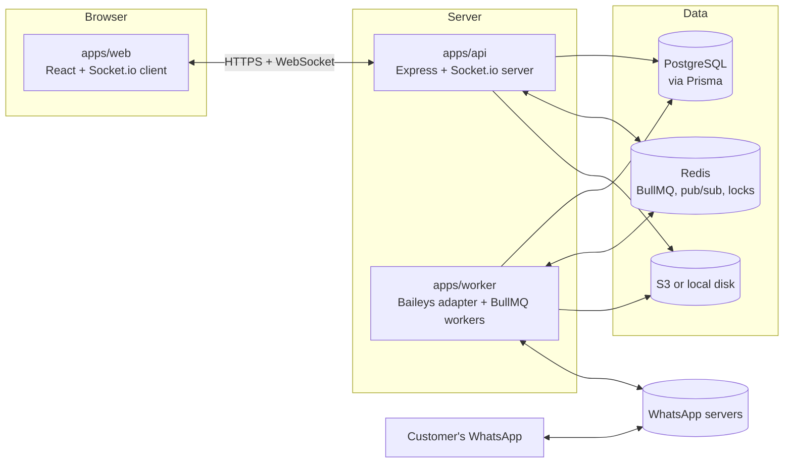
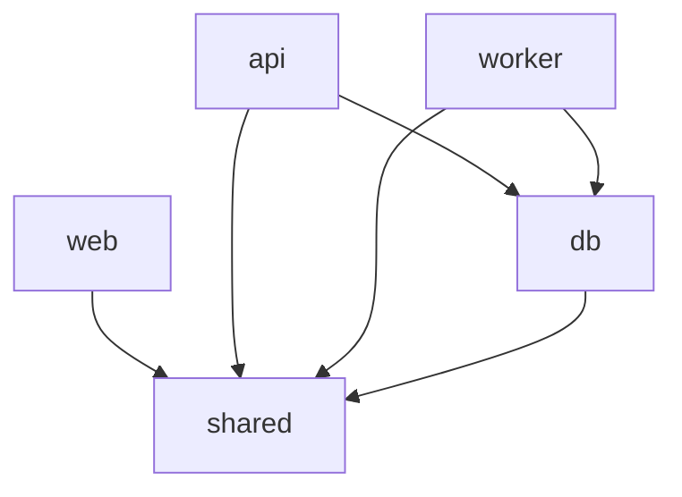
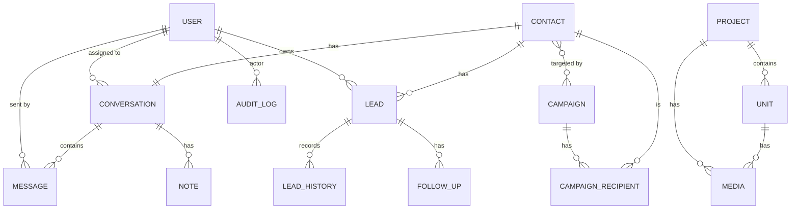
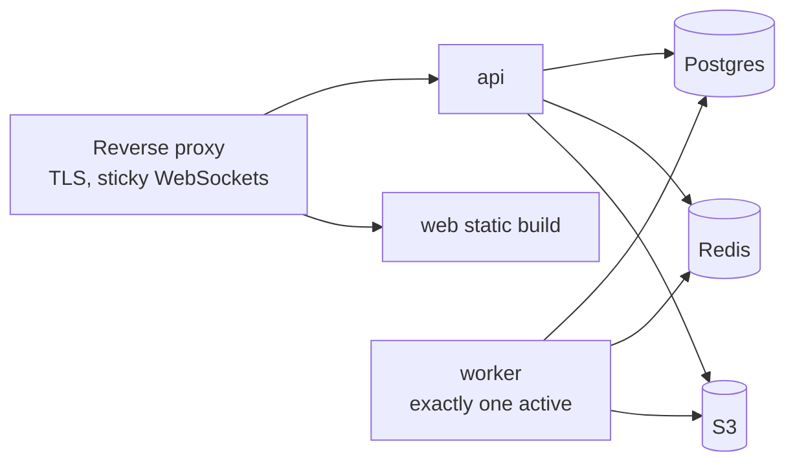

# Architecture — Real-estate WhatsApp CRM

The system is three Node.js processes — a React web app, an Express API and a WhatsApp worker — sharing one PostgreSQL database and one Redis instance. The API never talks to WhatsApp; only the worker does, and only through a provider interface, so the unofficial Baileys library can later be replaced by the official WhatsApp Cloud API without touching the rest of the app.

Related documents: [development-plan.md](./development-plan.md) · [data-flow.md](./data-flow.md)

---

## 1. System overview



| Component | Responsibility | Never does |
|---|---|---|
| **apps/web** | UI for inbox, leads, properties, follow-ups, campaigns, reports, connection page | Make security decisions (hiding a button is not access control) |
| **apps/api** | Auth, permissions, validation, business rules, writes, enqueues jobs, pushes live events to browsers | Import Baileys or hold a WhatsApp connection |
| **apps/worker** | Owns the WhatsApp session; receives messages and receipts; executes send, campaign and reminder jobs | Serve HTTP to browsers |
| **PostgreSQL** | Source of truth; unique constraints are the main duplicate defence | — |
| **Redis** | BullMQ queues, pub/sub between worker and API, reply locks, single-session lock, rate limits | Hold anything that cannot be rebuilt |
| **File storage** | Property photos and brochures; served via short-lived signed URLs | Serve files publicly |

---

## 2. Monorepo layout

```
apps/
  web/        React + TypeScript (Vite), Socket.io client
  api/        Express + TypeScript, Socket.io server
  worker/     WhatsApp provider adapter(s) + BullMQ processors
packages/
  shared/     Zod schemas, inferred types, enums, event + job contracts,
              provider interface, permission map
  db/         Prisma schema, migrations, client, seed
docs/         Plans, specs, diagrams, guides
```

**Dependency direction** (enforced by lint):



- `shared` depends on nothing internal.
- Only `apps/worker/src/providers/baileys/**` may import Baileys.
- `web` never imports `db`.

---

## 3. Key design decisions

| # | Decision | Why | Trade-off |
|---|---|---|---|
| 1 | **Provider interface** between the app and WhatsApp | Baileys is unofficial; production should use WhatsApp Cloud API. Swapping becomes one adapter. | Must normalise two different payload models into one shape. |
| 2 | **Separate worker process** for WhatsApp | A crash or reconnect loop in Baileys cannot take down the API; the API can scale without opening extra WhatsApp sessions. | Needs Redis to communicate. |
| 3 | **Zod in `packages/shared` as single source of truth** | One definition validates API input, types the frontend, and types events/jobs. | Prisma models must be kept in sync by hand (checked in review). |
| 4 | **Unique constraints over app-level checks** for dedupe | Survive races and crashes; app checks don't. | Writes must handle constraint violations as "already done". |
| 5 | **Queue every outbound send** (BullMQ) | Retries, rate limits, crash safety, idempotency by job ID. | Send is asynchronous; UI shows `queued` first. |
| 6 | **Server-side sessions in Redis** (httpOnly cookie) | Deactivating a user takes effect on the next request; simpler than JWT revocation. | Requires Redis on every request (already a dependency). |
| 7 | **Socket rooms joined only by the server** | Employees can't subscribe to chats they don't own. | Room membership must be updated on reassignment. |
| 8 | **Forward-only message status** | Never show a tick WhatsApp didn't report; ignore late/out-of-order receipts. | A missing receipt leaves a message at its last known status. |

---

## 4. WhatsApp provider interface

The interface lives in `packages/shared`; adapters live in `apps/worker`.

| Capability | Direction | Notes |
|---|---|---|
| Connect / disconnect / logout | App → provider | Logout clears the stored session |
| Send text | App → provider | Returns the provider's message ID |
| Send media (image, PDF) | App → provider | Takes a file reference, not raw bytes in the job |
| On incoming message | Provider → app | Normalised payload: provider message ID, from (E.164), type, text/media ref, timestamp, from-me flag |
| On message status | Provider → app | Provider message ID + `sent` / `delivered` / `read` / `failed` |
| On connection state | Provider → app | `connecting`, `qr_required` (+ QR string), `connected`, `disconnected`, `reconnect_required` |

**Adapters**

| Adapter | Use | Status |
|---|---|---|
| Fake | All automated tests; can simulate messages, receipts, drops, failures | Built in Phase 1 |
| Baileys | Development and demo with a test number | Built in Phase 1, pinned exact version |
| WhatsApp Cloud API | Production path | Documented; not built |

---

## 5. Data model (overview)



| Entity | Key constraint | Purpose |
|---|---|---|
| User | unique email | Login, role, active flag |
| Contact | unique phone (E.164) | One record per WhatsApp number; test flag; opted-out flag |
| Conversation | unique contact | One thread per contact; assignee, state, unread count |
| Message | unique provider message ID | Direction, type, body/media, status, sender, provider timestamp |
| Note | — | Internal only; never sent to WhatsApp |
| Lead | partial unique: one *open* lead per contact | Needs, stage, owner |
| LeadHistory | append-only | Every stage/assignment/field change |
| FollowUp | unique (follow-up, send attempt) | Reminder at most once |
| Project / Unit / Media | — | Catalogue and files |
| Campaign / CampaignRecipient | unique (campaign, contact) | No double sends after a crash |
| OptOut | unique phone | Checked before every campaign send |
| WhatsAppSession | one row per number | Encrypted credentials |
| AuditLog | insert-only | Accountability trail |

---

## 6. Security architecture

**Authentication**
- Email + password; passwords hashed with argon2 (or bcrypt).
- Session ID in an httpOnly, Secure, SameSite cookie; session data in Redis.
- Login rate-limited per email.

**Authorisation**
- One permission map in `packages/shared` (role → permissions).
- Every Express route declares its permission; a test fails if any route has none.
- Data scoping in queries: Employees only ever query their own conversations and leads.
- Socket.io: handshake requires a valid session; rooms are joined by the server:

| Room | Members | Receives |
|---|---|---|
| `inbox:all` | Super Admin, Managers | Every conversation event |
| `user:<id>` | That user | Events for conversations/leads assigned to them |
| `admin` | Super Admin | QR codes, connection alerts |
| `global` | Everyone logged in | WhatsApp connection state banner |

**Data protection**
- WhatsApp session encrypted with AES-256-GCM; key from environment only.
- Files served through short-lived signed URLs; uploads checked by real content type (magic bytes) and size limit.
- Audit log is insert-only from application code.
- Secrets never logged; request logs redact phone numbers where not needed.

**Hard guards**
- Reply lock checked at the send endpoint.
- Single WhatsApp session per number (Redis lock).
- Test-numbers-only campaign switch on by default.

---

## 7. Reliability

| Concern | Mechanism |
|---|---|
| Duplicate inbound | Unique provider message ID |
| Duplicate outbound | Job ID = message ID; worker only sends messages still `queued` |
| Duplicate campaign send | Unique (campaign, contact) + status check before send |
| Duplicate reminder | Unique send record per follow-up |
| Worker crash | BullMQ re-runs stalled jobs; idempotency above makes that safe |
| WhatsApp drop | Exponential backoff reconnect (1 s → 60 s cap); `reconnect_required` on logout |
| Two workers | Redis lock with TTL + heartbeat; standby worker takes over after TTL |
| Config mistakes | Zod env validation at boot; process exits with a clear message |

---

## 8. Configuration (environment)

| Variable group | Used by | Examples |
|---|---|---|
| Database | api, worker | Postgres URL |
| Redis | api, worker | Redis URL |
| Auth | api | Session secret, cookie domain, allowed origins |
| Encryption | worker | Session encryption key (32 bytes) |
| Storage | api, worker | Driver (s3/local), bucket, region, signed-URL TTL |
| WhatsApp | worker | Provider (`fake` / `baileys`), reconnect limits |
| Campaigns | worker | Send rate, test-only default |

Each app has its own Zod env schema; missing or invalid values stop the process at boot.

---

## 9. Deployment



- **Development:** Docker Compose for Postgres and Redis; apps run locally; `WHATSAPP_PROVIDER=fake` by default.
- **Demo / staging:** one API, one worker, managed Postgres and Redis, S3 or local volume.
- **Scaling the API:** multiple instances work because events go through Redis pub/sub (Socket.io Redis adapter) and sessions live in Redis.
- **Scaling the worker:** only one may hold the WhatsApp session; a second runs as warm standby.

---

## 10. Production path

- Replace the Baileys adapter with a WhatsApp Cloud API adapter (webhook-driven: inbound and status receipts arrive over HTTPS instead of a socket).
- Cloud API brings message templates and the 24-hour customer-service window; campaign sending must switch to approved templates.
- Everything above the provider interface stays the same.