# Data Flow — Real-estate WhatsApp CRM

Every flow follows the same pattern: **validate → write to Postgres → enqueue or publish → push to the right browsers**. Postgres is always written before anything is queued or broadcast, so a crash at any point leaves either nothing or a recoverable record — never an orphaned job or a phantom message.

Related documents: [development-plan.md](./development-plan.md) · [architecture.md](./architecture.md)

---

## Contents

1. [Incoming message](#1-incoming-message)
2. [Outgoing message](#2-outgoing-message)
3. [Message status receipts](#3-message-status-receipts)
4. [WhatsApp connection and QR](#4-whatsapp-connection-and-qr)
5. [Assignment and reply lock](#5-assignment-and-reply-lock)
6. [Lead lifecycle](#6-lead-lifecycle)
7. [Sharing a property](#7-sharing-a-property)
8. [Follow-up reminders](#8-follow-up-reminders)
9. [Campaigns](#9-campaigns)
10. [Audit log](#10-audit-log)
11. [Reports and export](#11-reports-and-export)
12. [Event and job reference](#12-event-and-job-reference)

---

## 1. Incoming message

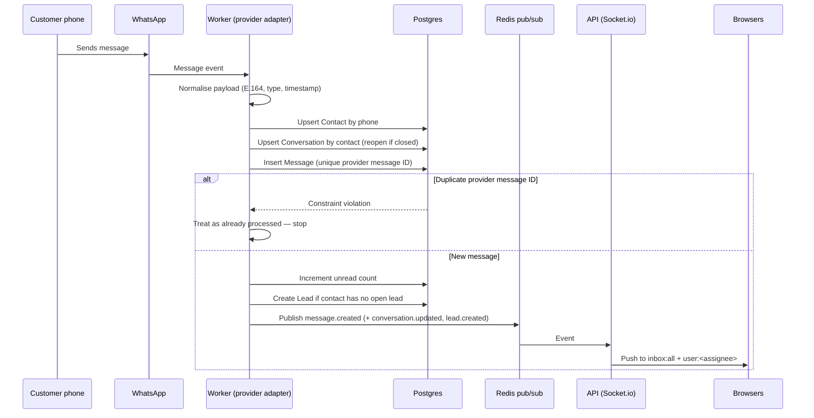

**Rules**
- Group chats and status broadcasts are ignored (counted in logs).
- Media messages store a typed record; downloading media is a separate step.
- Messages sent directly from the company phone arrive with a from-me flag and are stored as outbound with no CRM sender ("Sent from phone").
- Ordering in the UI uses the WhatsApp timestamp, not arrival time.

---

## 2. Outgoing message

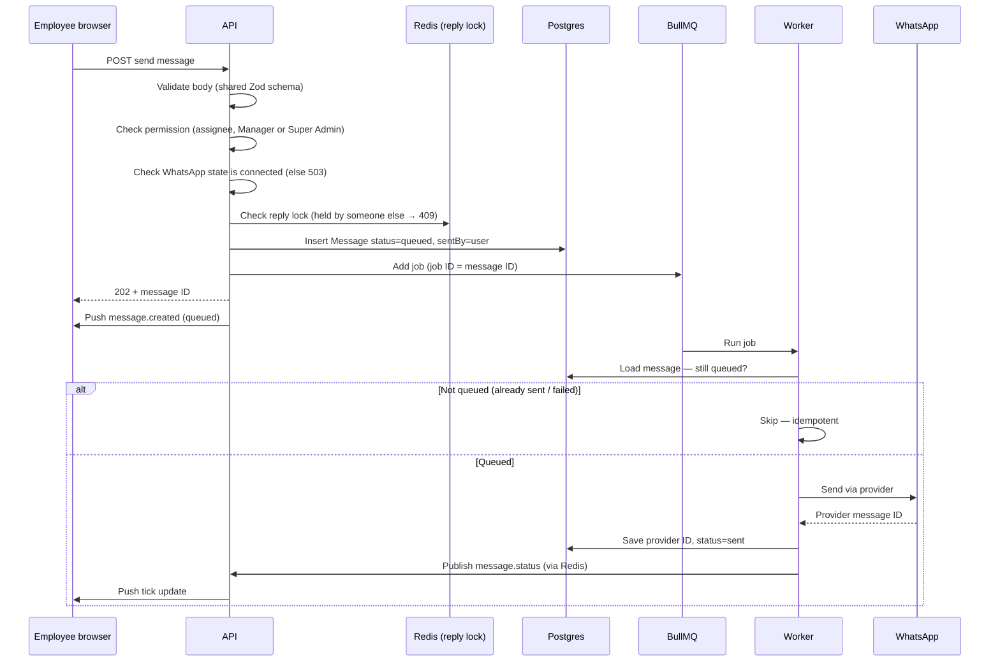

**Failure path:** the job retries 3 times with exponential backoff. After the last attempt the worker sets `failed` with a reason and publishes `message.status`; the sender sees a failed marker and can resend (which creates a new message).

---

## 3. Message status receipts

Ticks only move forward and only come from what WhatsApp reported.

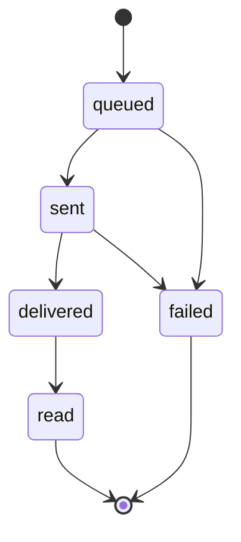

| Incoming receipt | Current status | Result |
|---|---|---|
| delivered | sent | → delivered |
| read | sent or delivered | → read |
| delivered | read | Ignored (would move backwards) |
| sent | delivered | Ignored |
| any | unknown provider ID | Ignored (logged) |

The transition rule is one pure function in `packages/shared`, used by the worker and covered by unit tests.

---

## 4. WhatsApp connection and QR

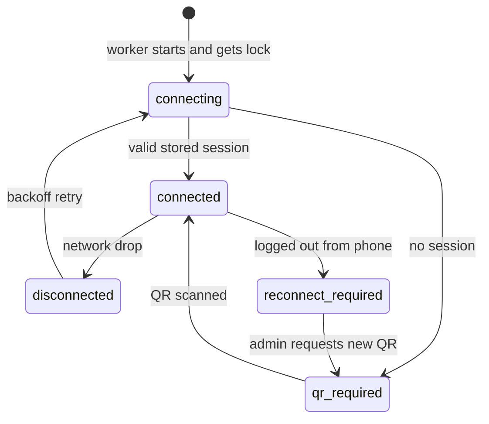

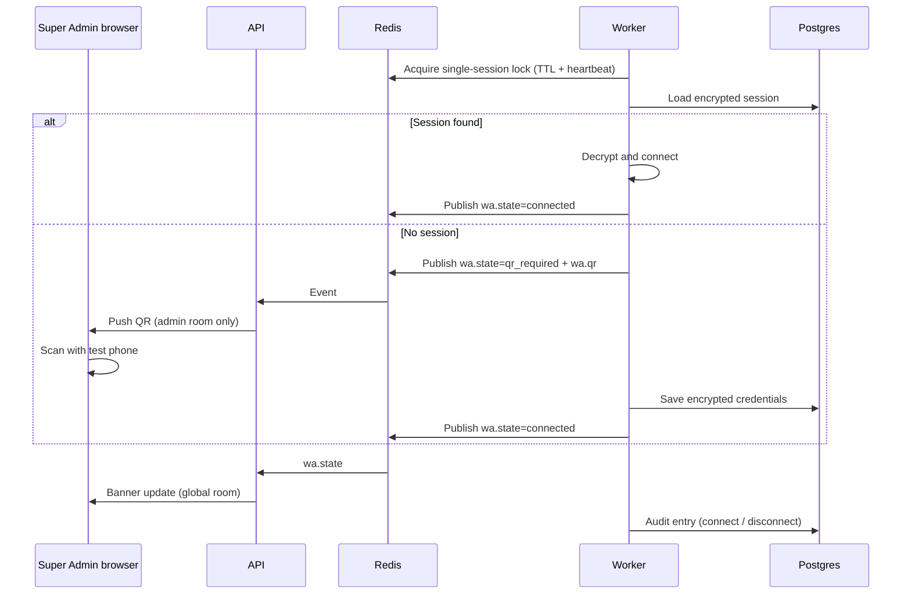

- Credentials are re-saved (encrypted) every time WhatsApp updates them.
- A second worker that cannot get the lock stays idle and retries the lock; it never opens a WhatsApp socket.

---

## 5. Assignment and reply lock

**Assignment**

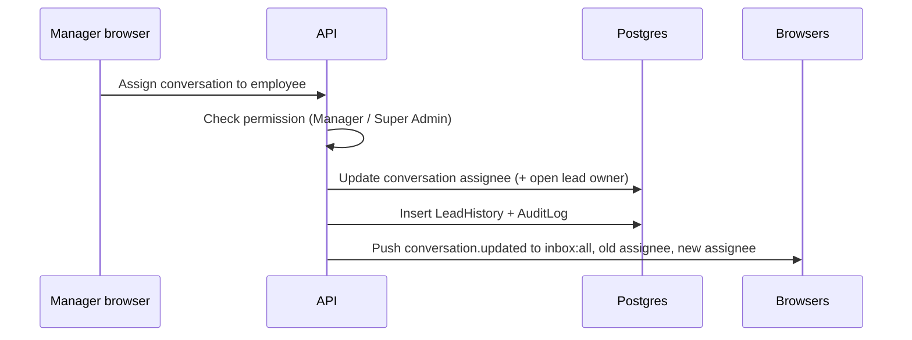

The old assignee's browser removes the chat; the new assignee's browser adds it. Room-based push means the old assignee receives no further messages for it.

**Reply lock** ("someone is replying")

| Step | What happens |
|---|---|
| Start typing | Browser asks API to take the lock → Redis key per conversation with the user ID and a short TTL |
| Keep typing | Browser refreshes the lock; TTL extends |
| Someone else opens the chat | They see "X is replying" (pushed via `conversation.lock`) |
| Someone else presses send | Send endpoint checks the lock → **409** if held by another user |
| Send or stop typing | Lock released, or expires on its own after TTL |

The lock is enforced at the send endpoint; the UI indicator is only a convenience.

---

## 6. Lead lifecycle

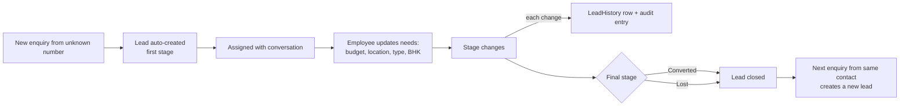

- At most one open lead per contact (enforced by a partial unique index).
- Every field, stage and owner change writes a LeadHistory row with old value, new value, user and time.
- Employees can only read and update leads they own.
- Stage names and order come from the LEAD spec.

---

## 7. Sharing a property

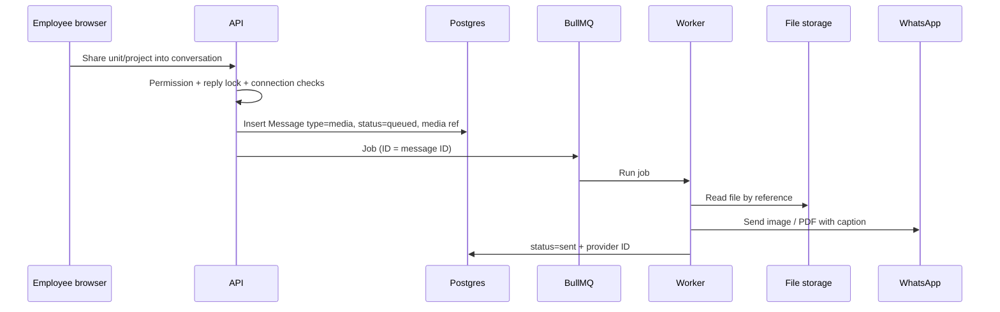

**Uploads:** the browser uploads to the API; the API checks the real content type from the file bytes and the size limit, stores it, and saves a Media row. Files are only ever served through short-lived signed URLs.

---

## 8. Follow-up reminders

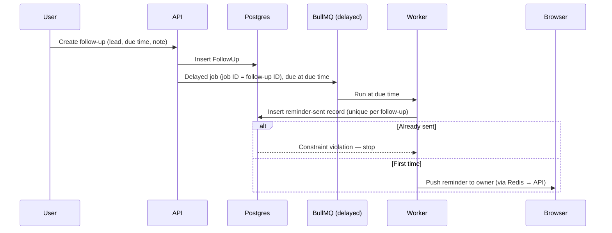

- **Overdue / upcoming lists** are plain queries on due time and completion state.
- **Test-mode auto-replies** run only from a "Run now (test)" button, only to test contacts, and are labelled as simulated.
- Editing a follow-up's due time replaces its delayed job.

---

## 9. Campaigns

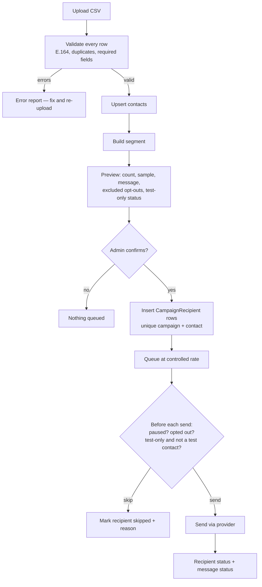

| Guard | Where it is enforced |
|---|---|
| Opt-out | Checked by the worker immediately before every send, not only at preview |
| Test-numbers-only | On by default; worker skips any non-test contact while on |
| No double send | Unique (campaign, contact) + recipient status checked before send |
| Rate | BullMQ rate limiter on the campaign queue |
| Pause / resume | Campaign status checked before each send; paused jobs wait |
| Audit | Create, confirm, pause, resume, finish all write audit entries |

---

## 10. Audit log

| Action | Written by | Key fields |
|---|---|---|
| Login / logout / failed login | API | user (if known), IP |
| Assignment / reassignment | API | conversation, from, to |
| Lead stage change | API | lead, old stage, new stage |
| User created / deactivated / role changed | API | target user, change |
| Campaign create / confirm / pause / resume / finish | API, worker | campaign, counts |
| WhatsApp connect / disconnect / logout | Worker | state, reason |

The audit table is insert-only from application code. The audit entry is written in the same transaction as the change it records, so a change never exists without its entry.

---

## 11. Reports and export

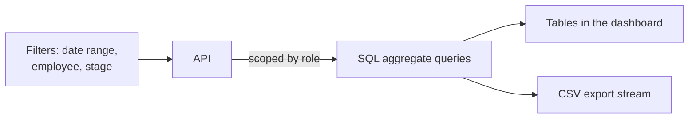

- Employees see only their own figures; Managers and the Super Admin see everyone.
- Exports stream rows instead of building the whole file in memory.
- Figures are computed from stored records; nothing in reports is estimated.

---

## 12. Event and job reference

**Live events** (Redis pub/sub → Socket.io)

| Event | Published by | Pushed to |
|---|---|---|
| `message.created` | worker (inbound), API (outbound) | `inbox:all`, `user:<assignee>` |
| `message.status` | worker | `inbox:all`, `user:<assignee>` |
| `conversation.updated` | API, worker | `inbox:all`, old and new assignee |
| `conversation.lock` | API | `inbox:all`, `user:<assignee>` |
| `lead.created` / `lead.updated` | worker, API | `inbox:all`, `user:<owner>` |
| `followup.due` | worker | `user:<owner>` |
| `campaign.progress` | worker | `admin`, Managers |
| `wa.state` | worker | `global` |
| `wa.qr` | worker | `admin` |

**Queues** (BullMQ)

| Queue | Job ID | Retries | Idempotency guard |
|---|---|---|---|
| `outbound-message` | message ID | 3, exponential | Send only if still `queued` |
| `campaign-send` | campaign ID + contact ID | 3, exponential | Unique recipient row + status check |
| `followup-reminder` | follow-up ID (delayed) | 3 | Unique reminder-sent record |
| `media-download` | provider message ID | 3 | Skip if media already stored |

Every event and job payload has a Zod schema in `packages/shared` and carries a schema version.