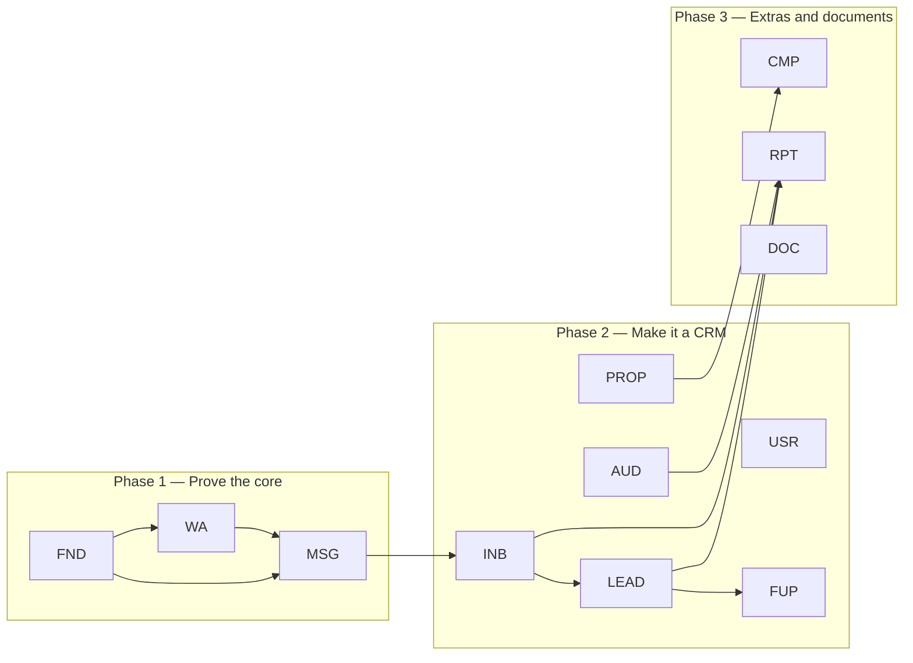

# Development Plan — Real-estate WhatsApp CRM

The CRM is built in three phases. Each phase ends with a checkpoint that must pass on a real test phone before the next phase starts. Every feature is driven by a spec with numbered acceptance criteria; no code is written that no criterion asks for.

Related documents: [architecture.md](./architecture.md) · [data-flow.md](./data-flow.md)

---

## 1. Working method (spec-driven)

Every feature goes through the same five steps:

1. **Spec** — goal, scope / out of scope, acceptance criteria (`AREA-NN`), edge cases, manual check.
2. **Contracts** — Zod schemas, Prisma models, event and job types the criteria need. Types only, no behaviour.
3. **Failing tests** — one test per criterion, titled with its ID (e.g. `MSG-04 inbound message reaches only authorised rooms`).
4. **Code** until those tests pass.
5. **Verify** — run the spec's manual check, then tick the criterion.

**Rules**

- If a spec turns out to be wrong: change the spec, then the test, then the code.
- Criterion IDs are never reused. A dropped criterion is struck through, not deleted.
- One module at a time. A module is "done" only when all its *Must* criteria are green.
- Priorities: **Must** (blocks the checkpoint), **Should** (do in the phase if time allows), **Could** (only if trivial).

### Spec areas

| Prefix | Area | Phase |
|---|---|---|
| `FND` | Foundation, auth, roles, config | 1 |
| `WA` | WhatsApp connection (provider, QR, session, lock) | 1 |
| `MSG` | Message flow (inbound, outbound, status, dedupe) | 1 |
| `INB` | Shared inbox (assignment, states, notes, reply lock) | 2 |
| `LEAD` | Leads (fields, stages, history, auto-creation) | 2 |
| `PROP` | Properties (projects, units, media, share to chat) | 2 |
| `FUP` | Follow-ups (reminders, overdue/upcoming, test auto-replies) | 2 |
| `AUD` | Audit log | 2 |
| `USR` | User management (create, deactivate, role change) | 2 |
| `CMP` | Campaigns (CSV, segments, queue, opt-out, test-only switch) | 3 |
| `RPT` | Dashboard and reports | 3 |
| `DOC` | Project documentation | 3 |

---

## 2. Phase overview

| Phase | Goal | Modules | Checkpoint |
|---|---|---|---|
| 1 | A real WhatsApp message can go in and out of the CRM reliably | FND, WA, MSG | Message the test number from a phone → it appears in the CRM → reply → reply arrives on the phone. Restart the server → still connected without a new QR. |
| 2 | The team can actually work leads through the inbox | INB, LEAD, PROP, FUP, AUD, USR | Two employees in two browsers see the same chat live; the reply lock blocks the second sender; a lead moves through its stages with history recorded. |
| 3 | Safe outreach, management visibility, handover docs | CMP, RPT, DOC | End-to-end run through every module (see §6). |

---

## 3. Phase 1 — Prove the core works

**Build order inside the phase** (each step unblocks the next):

1. **Repo and infrastructure** — monorepo, strict TypeScript, lint rule banning `any`, Docker Compose for Postgres + Redis, env validation with Zod, `/health`. (`FND-01`, `02`, `12`)
2. **Schema and seed** — User, Contact, Conversation, Message, WhatsAppSession, AuditLog; seed with one user per role and test contacts. (`FND-03`, `04`)
3. **Provider interface + fake provider** — the boundary every WhatsApp-facing test uses. (`WA-01`, `02`)
4. **Auth and permissions** — session login, server-side permission map, socket handshake auth, server-controlled rooms. (`FND-05` – `09`)
5. **Message flow against the fake provider** — inbound store + dedupe, auto contact/conversation, live push, outbound via queue, forward-only status, retries, disconnected guard. (`MSG-01` – `12`)
6. **Real Baileys adapter** — QR page, connection states, encrypted session, restart without QR, single-session Redis lock, backoff reconnect. (`WA-03` – `12`)
7. **Should items**, then the checkpoint.

**Deliverables**
- Running monorepo with `web`, `api`, `worker`, `shared`, `db`.
- Super Admin connection page with live QR and status banner.
- Minimal message list proving inbound/outbound (full inbox UI comes in Phase 2).
- Risk write-up started: Baileys version and licence, unofficial-client status, ban risk, fallback plan.

**Phase 1 risks**

| Risk | Mitigation |
|---|---|
| Baileys breaks or behaves differently than expected | Exact version pin; all logic tested against the fake provider first; adapter is the only file that changes |
| Duplicate inbound messages on reconnect | Unique constraint on WhatsApp message ID, not app-level checks |
| Two workers connecting the same number | Redis lock with TTL + heartbeat at worker start |

---

## 4. Phase 2 — Make it a CRM

**Build order inside the phase**

1. **USR** — user create / deactivate / role change (Super Admin + Manager), deactivation keeps history.
2. **INB** — chat list + chat panel, assign / reassign, open / pending / closed, unread count, internal notes, reply lock enforced at the send endpoint, sender name on every message, disconnected banner.
3. **LEAD** — lead fields (budget, location, type, BHK), seven stages, assignment, full change history, auto-created from new enquiries, at most one open lead per contact, employees see only their own.
4. **AUD** — append-only audit entries for logins, assignments, stage changes, WhatsApp connects/disconnects (campaign actions added in Phase 3).
5. **PROP** — projects and units, photos and brochure PDFs (content-type checked by file bytes), search, share a property into a chat.
6. **FUP** — reminders, overdue and upcoming lists, test-mode auto-replies as "Run now (test)" buttons, reminder sent at most once.

**Phase 2 open decisions** (must be settled in the spec before tests)

- The names and order of the seven lead stages — take them from the spec, do not invent them.
- Reply-lock timeout length and whether a Manager can override it.
- Whether closing a conversation also closes its open lead.

---

## 5. Phase 3 — Extras and documents

**CMP — Campaigns (safe mode)**
- CSV import with per-row validation and an error report.
- Segments built from contacts and lead fields.
- Preview → confirm step; nothing is queued before confirmation.
- Queued sending at a controlled rate, pause / resume.
- Opt-out list checked immediately before every single send.
- Unique (campaign, contact) key so a crash never causes a double send.
- Test-numbers-only switch, **on by default**; only test contacts are eligible while it is on.

**RPT — Dashboard and reports**
- Counts of leads (by stage), chats (by state), follow-ups (overdue / upcoming).
- Per-employee performance: assigned chats, replies sent, leads converted, median first-response time.
- Filters (date range, employee, stage) and CSV export. Tables, not charts.

**DOC — Documentation**
- Architecture and ER diagrams.
- Setup and environment guide (every env var explained).
- Backup and restore steps for Postgres and the WhatsApp session.
- Test results (generated from criterion-ID test titles).
- Known limitations (including everything labelled "simulated").
- User guides for Super Admin, Manager and Employee.
- Cost estimate, including the WhatsApp Cloud API production path.

---

## 6. Final checkpoint — end-to-end run

1. Create a lead and assign it to an employee.
2. The employee logs in and sees it — and nothing assigned to others.
3. A test message arrives; the employee replies; the reply lands on the phone with real ticks.
4. Share a property brochure into the chat.
5. Run a safe campaign to test contacts; show the opted-out number being skipped.
6. Disconnect WhatsApp and reconnect it; the banner appears and clears.
7. Open the reports and the audit log; every action above is recorded.

---

## 7. Test strategy

| Level | Tooling | Proves |
|---|---|---|
| Unit | Vitest | Pure rules: status transitions, permission map, encryption, CSV validation, rate maths |
| Integration | Vitest + Supertest, Postgres and Redis in Docker | Routes, permissions, constraints, transactions |
| Socket | socket.io-client per seeded role | Room isolation and live push |
| Worker | Worker wired to the fake provider | Inbound, queue, retries, reconnect, lock, campaigns |
| E2E (optional) | Playwright, two browser contexts | Two-employee live inbox and reply lock |
| Manual | Real test phone + test number | QR, restart, real delivery/read ticks |
| CI script | Typecheck, lint, Baileys import boundary, exact version pin, criterion traceability | Hard rules |

**Traceability:** a script lists every `AREA-NN` criterion in the specs that has no test with that ID in its title. A phase cannot close with a missing *Must*.

---

## 8. Definition of done (any criterion)

- Its test passes in CI.
- Enforcement is on the server, never only in the UI.
- Anything simulated is labelled as simulated in the UI.
- No WhatsApp tick is shown that the provider did not report.
- Only test numbers and test contacts were used.

---

## 9. Cross-phase risks

| Risk | Impact | Mitigation |
|---|---|---|
| Baileys is unofficial | Can break on WhatsApp updates; not supported by Meta | Provider interface; Cloud API adapter documented as the production path |
| Number gets restricted | CRM stops working | Test number only, controlled send rate, test-only campaign switch |
| Scope creep | Unfinished core | No code without a criterion; one module at a time |
| Permission leaks | Employees see others' data | Server-side checks on routes and socket rooms, covered by Socket tests |
| Data loss | Lost chats or session | Documented backup/restore; session can always be re-paired by QR |